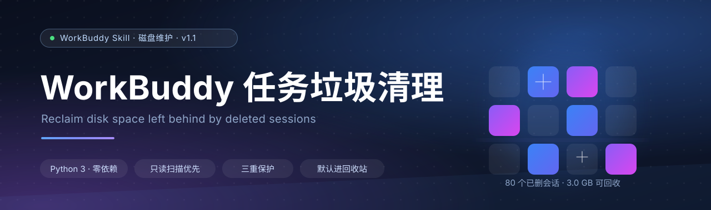
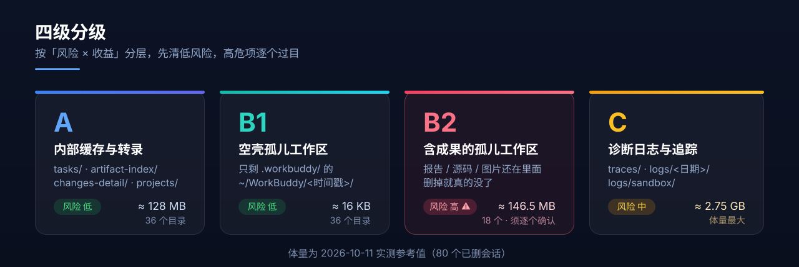
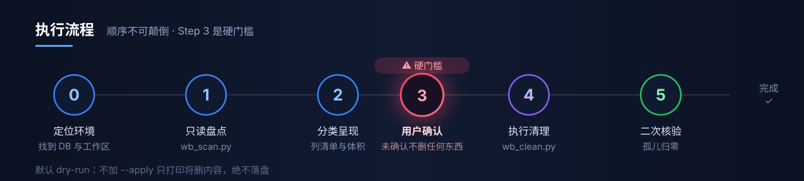
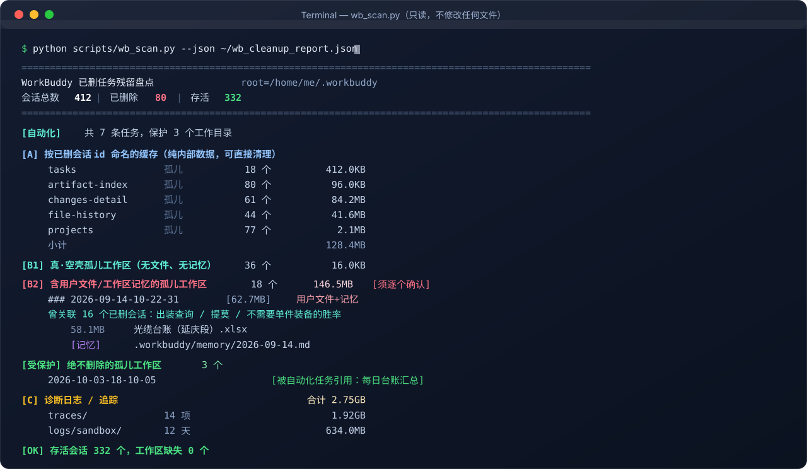
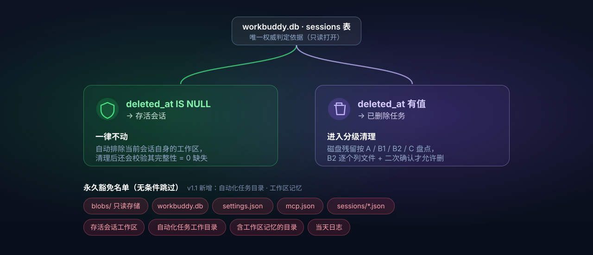

<div align="center">



<br />

<a href="./LICENSE"></a>
&nbsp;
&nbsp;
&nbsp;
&nbsp;

<br />
<br />

### 删掉的对话，别再占着你的硬盘。

把 WorkBuddy 里「已删除任务」遗留的孤儿文件找出来 ——<br />
**先只读扫描、列清楚清单，等你点头，才动手删。**

<br />

[**快速开始**](#-快速开始) &nbsp;·&nbsp; [**分级说明**](#-四级分级) &nbsp;·&nbsp; [**安全设计**](#-安全设计) &nbsp;·&nbsp; [**常见问题**](#-常见问题-faq)

</div>

---

## 🧐 这解决什么问题

WorkBuddy 用久了，你大概率遇到过下面这些事：

| 症状 | 背后的真相 |
| :--- | :--- |
| 💾 磁盘莫名其妙少了好几个 GB | 删掉的对话，磁盘上的文件并没有跟着一起走 |
| 🗑️ 侧边栏里早就没了的任务，还在占空间 | 任务记录删了，但 `tasks/`、`changes-detail/`、`projects/` 下的数据留了下来 |
| 📁 `~/WorkBuddy/` 里堆着一长串时间戳目录 | 每次新建对话都会生成一个 playground 工作区，对话删了，目录还在 |
| 🧹 想手动清理，又不敢下手 | 分不清哪个目录属于"活着的"任务，删错了回不来 |
| 🐌 目录索引越来越大、磁盘越来越紧张 | `traces/` 和沙箱日志能悄悄涨到好几个 GB |

**本工具要做的事很简单：把"哪些能删、哪些碰不得"用数据库里的权威字段讲清楚，然后由你自己拍板。**

> 💡 实测一次：**80 个已删会话**，可回收约 **3.0 GB**（明细见 [实测效果](#-实测效果)）。

---

## 🔍 核心原理：凭什么判断"这是垃圾"

不猜、不看目录时间、不信侧边栏 —— 只认一个权威依据：

> **`~/.workbuddy/workbuddy.db` → `sessions` 表 → `deleted_at` 字段**

| 字段值 | 含义 | 处理方式 |
| :--- | :--- | :--- |
| `deleted_at IS NULL` | ✅ **存活会话** | 它的数据一律不动 |
| `deleted_at` 有值 | 🗑️ **已删除任务** | 它在磁盘上的残留，就是"垃圾" |

**为什么不能用别的方法判断？**

- ❌ **看目录修改时间** —— 存活会话的缓存也可能很久没更新，会误伤
- ❌ **看目录是否为空** —— 空目录也可能正被存活会话引用
- ❌ **看侧边栏任务列表** —— 那只是快照，且不含后台任务

数据库以 **只读模式**（`mode=ro`）打开，全程不写入一个字节。

---

## 🗂️ 四级分级

不同级别的风险天差地别，所以拆开处理，分开确认。



| 级别 | 内容 | 典型路径 | 风险 | 实测体量 |
| :---: | :--- | :--- | :---: | ---: |
| **A** | 内部缓存与会话转录 | `tasks/` `artifact-index/` `changes-index/` `changes-detail/` `file-history/` `assistant-display/` `projects/` | 🟢 低 | ≈ 128 MB |
| **B1** | 空壳孤儿工作区 | `~/WorkBuddy/<时间戳>/`，里面只剩 `.workbuddy/` | 🟢 低 | ≈ 16 KB |
| **B2** | **含成果文件**的孤儿工作区 | `~/WorkBuddy/<时间戳>/`，里面还有你的报告 / 源码 / 图片 | 🔴 **高** | ≈ 146.5 MB |
| **C** | 诊断日志与运行追踪 | `traces/` `logs/<日期>/` `logs/sandbox/` | 🟡 中 | ≈ 2.75 GB |

> ⚠️ **B2 是唯一需要逐个人工过目的类别** —— 那里面装的是你自己的劳动成果，不是缓存。
> 删 C 之前也请想清楚：删完就失去了历史排障线索。

---

## 🚦 执行流程



**顺序不可颠倒，第 3 步是硬门槛：**没拿到你明确的选择之前，一个字节都不会删。

---

## 🚀 快速开始

### 1. 安装 Skill

<details open>
<summary><b>方式一 · 下载分发包（推荐）</b></summary>

从本仓库的 [`dist/workbuddy-task-cleanup.zip`](./dist/workbuddy-task-cleanup.zip) 下载，解压到 skills 目录。

**Windows（PowerShell）**

```powershell
Expand-Archive -Path workbuddy-task-cleanup.zip -DestinationPath "$env:USERPROFILE\.workbuddy\skills" -Force
```

**macOS / Linux**

```bash
unzip workbuddy-task-cleanup.zip -d ~/.workbuddy/skills/
```

</details>

<details>
<summary><b>方式二 · git clone</b></summary>

```bash
git clone https://github.com/Lemon177777/workbuddy-task-cleanup.git \
  ~/.workbuddy/skills/workbuddy-task-cleanup
```

</details>

<details>
<summary><b>方式三 · 手动复制</b></summary>

把本仓库的 `SKILL.md`、`scripts/`、`references/` 放进同一个目录即可：

```text
~/.workbuddy/skills/workbuddy-task-cleanup/
```

</details>

装完之后，在 WorkBuddy 里直接说一句：

> **「清理 workbuddy 垃圾」** / **「WorkBuddy 占空间太大」** / **「清理已删除任务的残留」**

Skill 就会被触发，按流程先给你一份只读报告。

### 2. 或者，直接用脚本（不装 Skill 也能跑）

脚本**只用标准库**，Python 3.8+ 即可，不需要 `pip install` 任何东西。

```bash
# ① 只读盘点 —— 放心跑，绝不修改任何文件
python scripts/wb_scan.py --json ~/wb_cleanup_report.json

# ② 预览将删除的内容（默认 dry-run，不落盘）
python scripts/wb_clean.py --tiers A,B1,C

# ③ 看过预览、确认无误后，才真正执行
python scripts/wb_clean.py --tiers A,B1,C --apply

# ④ 想连 B2 一起清，必须额外显式声明（因为它含你的成果文件）
python scripts/wb_clean.py --tiers A,B1,C,B2 --include-b2 --apply

# ⑤ 二次核验（务必重跑一次，删除钩子可能延迟落盘）
python scripts/wb_scan.py
```

<details>
<summary><b>命令行参数一览</b></summary>

| 参数 | 默认值 | 说明 |
| :--- | :--- | :--- |
| `--tiers A,B1,C` | *（必填）* | 要处理的类别，逗号分隔，可选 `A` `B1` `B2` `C` |
| `--apply` | 关闭 | 真正删除。**不加时只预览，不落盘** |
| `--include-b2` | 关闭 | 允许处理 B2（含用户成果文件的孤儿工作区） |
| `--workbuddy` | `~/.workbuddy` | WorkBuddy 数据目录 |
| `--workspaces` | `~/WorkBuddy` | 工作区根目录 |
| `--json OUT` | — | （仅 scan）额外导出一份 JSON 报告 |

</details>

### 3. 你会看到这样的报告



---

## 🛡️ 安全设计



### 铁律

| # | 规则 |
| :---: | :--- |
| 1 | **先扫描 → 后呈现 → 再确认 → 末执行**，顺序不可颠倒 |
| 2 | **不动数据库**。只读打开，绝不写入 |
| 3 | **不碰 `blobs/`** —— 那是内容寻址存储，存活任务也在引用，删了会破坏数据 |
| 4 | **B2 必须逐个列文件 + 二次确认** —— 那是你的成果，不是缓存 |
| 5 | **删完必须二次核验**，并报告「存活会话工作区缺失 = 0」 |
| 6 | **保留当天的日志** `logs/<今天>/` 与 `logs/sandbox/<今天>/` |
| 7 | 用户要求永久删除时，**先加粗警告并列出受影响文件路径**，取得明确同意后才动手 |

### 三道保险

```text
① 默认 dry-run      不加 --apply，脚本只打印"将删什么"，绝不动盘
② 双重显式授权      B2 必须同时给出 --tiers B2 和 --include-b2
③ 事后完整性校验    每次清理后自动检查存活会话工作区，缺失必须为 0
```

---

## ⚖️ 和通用清理工具的区别

| 能力 | 系统磁盘清理 | 通用清理软件 | **本 Skill** |
| :--- | :---: | :---: | :---: |
| 认识 WorkBuddy 的数据结构 | ❌ | ❌ | ✅ 直读 `workbuddy.db` |
| 区分「已删」与「存活」任务 | ❌ | ❌ | ✅ 依据 `deleted_at` |
| 自动保护存活会话工作区 | ❌ | ❌ | ✅ 排除 + 事后校验 |
| 列出将被删除的**具体文件** | ❌ | ⚠️ 部分 | ✅ B2 逐个列清单 |
| 默认预览、不落盘 | ❌ | ❌ | ✅ dry-run 为默认 |
| 跨平台 | ⚠️ 仅 Windows | ⚠️ 部分 | ✅ Windows / macOS / Linux |
| 额外依赖 | 无 | 需安装 | ✅ 纯标准库，零依赖 |

一句话：**通用工具看的是"文件夹大不大"，本工具看的是"这个任务到底死没死"。**

---

## ❓ 常见问题 (FAQ)

<details>
<summary><b>会删掉我正在使用的对话吗？</b></summary>

不会。判定只依据 `sessions.deleted_at`：`IS NULL` 的存活会话，其工作区与数据一律跳过。
脚本还会自动把**当前正在运行的会话工作区**排除在外，清理后额外校验一次完整性。

</details>

<details>
<summary><b>我删掉的对话里的文件，还能找回来吗？</b></summary>

只要**还没清理过**，它们大概率还躺在 `~/WorkBuddy/<时间戳>/` 里 —— 这正是 **B2** 存在的意义。
把它们找回来，是可回收的那 146 MB 之外、更值钱的东西。

</details>

<details>
<summary><b>为什么清理完，目录好像还在？</b></summary>

这是本机 safe-delete 钩子的已知行为：删除会被转成回收站操作，且可能在 `rmtree()` 返回**之后**才真正落盘。
**所以必须重跑一次 `wb_scan.py` 做二次核验**，不要仅凭第一轮输出下结论。

</details>

<details>
<summary><b><code>logs/sandbox</code> 整目录删除失败？</b></summary>

已知坑。整目录删会报 `Some operations were aborted`，必须**按日期子目录**（如 `20261009/`）逐个删。
脚本已经这么做了，并且会保留当天。

</details>

<details>
<summary><b>macOS / Linux 能用吗？</b></summary>

能。两个脚本纯标准库，路径基于 `~/.workbuddy` 与 `~/WorkBuddy`，三个平台通用。
用 `python3` 代替 `python` 即可。

</details>

<details>
<summary><b>会不会动到我自己的项目文件？</b></summary>

不会。清理范围只有两处：`~/.workbuddy/` 内部的缓存与日志，以及 `~/WorkBuddy/<时间戳>/` 下的**孤儿**工作区。
你在别处创建的项目目录，不在扫描范围内。

</details>

<details>
<summary><b>能不能定期自动清理？</b></summary>

可以配一个定时任务只跑 **只读盘点**，把报告推给你；但**删除动作建议始终保留人工确认** ——
尤其 B2，那是你的成果文件，不该被自动化悄悄带走。

</details>

---

## 📦 目录结构

```text
workbuddy-task-cleanup/
├── SKILL.md                        # Skill 说明书（WorkBuddy 读取的入口）
├── scripts/
│   ├── wb_scan.py                  # ① 只读盘点（绝不修改文件）
│   └── wb_clean.py                 # ② 分级清理（默认 dry-run）
├── references/
│   └── orphan-map.md               # 数据目录地图 · 已知坑 · 参考体量
├── assets/                         # 图示与徽章（矢量 SVG）
├── dist/
│   └── workbuddy-task-cleanup.zip  # 可直接安装的分发包
├── docs/
│   └── index.html                  # GitHub Pages 展示页
├── LICENSE
└── CHANGELOG.md
```

---

## 📊 实测效果

2026-10-11 在真实机器上跑的一次（**80 个已删会话 / 412 个会话总数**）：

| 类别 | 数量 | 体量 |
| :--- | ---: | ---: |
| A · 内部缓存 + 会话转录 | 36 个目录 | ≈ 128 MB |
| B1 · 空壳孤儿工作区 | 36 个 | 16 KB |
| B2 · 含成果的孤儿工作区 | 18 个 | 146.5 MB |
| C · traces + logs | 26 项 | ≈ 2.75 GB |
| **合计** | | **≈ 3.0 GB** |

清理后二次核验：**存活会话工作区缺失 0**。

---

## 🧩 兼容性

| 项目 | 支持情况 |
| :--- | :--- |
| 操作系统 | Windows 10/11、macOS、Linux |
| Python | 3.8 及以上 |
| 第三方依赖 | **无**（仅标准库：`sqlite3` / `os` / `shutil` / `argparse` / `json`） |
| 需要管理员权限 | 否 |
| 会写数据库吗 | **不会**，全程只读 `mode=ro` |

---

## 📝 更新日志

见 [CHANGELOG.md](./CHANGELOG.md)。

---

## ⚠️ 免责声明

本工具会**删除磁盘文件**。虽然设计了「默认预览 + 分级确认 + 事后校验」三道保险，
但任何清理操作都存在风险 —— **请在看到文件清单并自行判断后再确认执行**。
B2 类别尤其如此：它装的是你自己的工作成果。

---

## 📄 许可

[MIT](./LICENSE) © 2026 [Lemon177777](https://github.com/Lemon177777)

<div align="center">
<br />

**如果它帮你找回了几十个 GB，也顺手找回了一份被删对话里的旧文件 —— 给个 ⭐ 吧。**

<sub>用 ❤️ 和一点点强迫症做的 · Made for WorkBuddy</sub>

</div>
