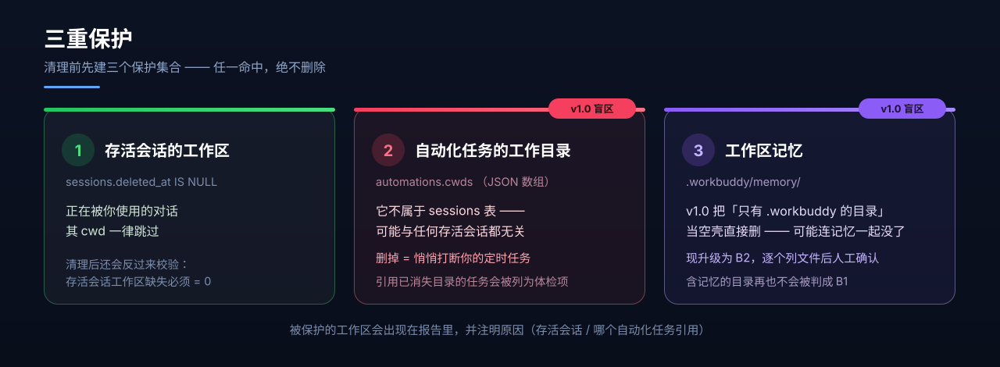

<div align="center">


<br />

<a href="./LICENSE"></a>
&nbsp;
&nbsp;
&nbsp;
&nbsp;

<br />
<br />

### 删掉的对话，别再占着你的硬盘。

把 WorkBuddy 里「已删除任务」遗留的孤儿文件找出来 ——<br />
**先只读扫描、列清楚清单，等你点头，才动手删。**

<br />

[**快速开始**](#-快速开始) &nbsp;·&nbsp; [**三重保护**](#-三重保护) &nbsp;·&nbsp; [**分级说明**](#-四级分级) &nbsp;·&nbsp; [**常见问题**](#-常见问题-faq)

</div>

---

## 🧐 这解决什么问题

WorkBuddy 用久了，你大概率遇到过下面这些事：

| 症状 | 背后的真相 |
| :--- | :--- |
| 💾 磁盘莫名其妙少了好几个 GB | 删掉的对话，磁盘上的文件并没有跟着一起走 |
| 🗑️ 侧边栏里早就没了的任务，还在占空间 | 任务记录删了，但 `tasks/`、`changes-detail/`、`projects/` 下的数据留了下来 |
| 📁 `~/WorkBuddy/` 里堆着一长串时间戳目录 | 每次新建对话都会生成一个 playground 工作区，对话删了，目录还在 |
| 🧹 想手动清理，又不敢下手 | 分不清哪个目录属于"活着的"任务，删错了回不来 |
| 🐌 目录索引越来越大、磁盘越来越紧张 | `traces/` 和沙箱日志能悄悄涨到好几个 GB |
| ⏰ **不敢清，怕把定时任务的目录删掉** | 自动化任务的工作目录**不在会话列表里**，肉眼根本看不出来 —— 所以本工具替你查 |

> 💡 实测一次：**80 个已删会话**，可回收约 **3.0 GB**（明细见 [实测效果](#-实测效果)）。

---

## 🛡️ 三重保护

> **这是 v1.1 最重要的改动** —— 补上了 v1.0 的两个盲区。删文件这件事，宁可少删，不可错删。



清理前会先建三个保护集合，**任一命中，绝不删除**：

| # | 保护对象 | 判定依据 | 为什么必须保护 |
| :---: | :--- | :--- | :--- |
| 1 | 存活会话的工作区 | `sessions.deleted_at IS NULL` 的 `cwd` | 你正在用的对话，动它等于自毁 |
| 2 | **自动化任务的工作目录** | `automations.cwds`（JSON 数组，过滤 `deleted_at IS NULL`） | ⚠️ **v1.0 盲区** —— 它不属于 `sessions` 表。一个工作区完全可能"没有任何存活会话引用"，却正是某个定时任务的运行目录。删掉 = **悄悄打断你的定时任务** |
| 3 | **工作区记忆** | `<工作区>/.workbuddy/memory/` 下存在文件 | ⚠️ **v1.0 盲区** —— v1.0 把「只有 `.workbuddy` 的目录」当空壳直接删，若里面只存着记忆，就会**连项目长期记忆一起删掉** |

被保护的工作区会出现在报告里，并**注明原因**（属于哪个存活会话 / 被哪个自动化任务引用）：

```text
[受保护] 绝不删除的孤儿工作区  3 个
    2026-10-03-18-10-05   [被自动化任务引用：每日台账汇总]
```

此外，若某条自动化任务引用的目录**已经不存在**（运行必然失败），扫描会把它列为**体检项**提醒你。

---

## 🔍 核心原理：凭什么判断"这是垃圾"

不猜、不看目录时间、不信侧边栏 —— 只认数据库里的权威字段。

| 表 | 关键字段 | 用来做什么 |
| :--- | :--- | :--- |
| `sessions` | `deleted_at` | 区分**存活**与**已删除**的会话 |
| `automations` | `cwds`（JSON 数组）、`deleted_at` | 找出**必须保护**的工作目录 |

```sql
-- 判定「垃圾」
SELECT id, cwd, title, deleted_at FROM sessions;
--   deleted_at IS NULL  -> ✅ 存活会话，数据一律不动
--   deleted_at 有值      -> 🗑️ 已删除任务，磁盘残留即"垃圾"

-- 判定「受保护」（v1.1 新增，v1.0 的盲区）
SELECT id, name, status, cwds, deleted_at FROM automations WHERE deleted_at IS NULL;
--   cwds 是 JSON 数组，不是逗号分隔字符串 —— 直接按逗号切会解析失败
```

**为什么不能用别的方法判断？**

- ❌ **看目录修改时间** —— 存活会话的缓存也可能很久没更新，会误伤
- ❌ **看目录是否为空** —— 空目录也可能正被存活会话引用，或者只装着工作区记忆
- ❌ **看侧边栏任务列表** —— 那只是快照，且**完全不含**自动化任务的工作目录

数据库以 **只读模式**（`mode=ro`）打开，全程不写入一个字节。

---

## 🗂️ 四级分级 + 受保护

不同级别的风险天差地别，所以拆开处理、分开确认。


| 级别 | 内容 | 典型路径 | 风险 | 实测体量 |
| :---: | :--- | :--- | :---: | ---: |
| **A** | 内部缓存与会话转录 | `tasks/` `artifact-index/` `changes-index/` `changes-detail/` `file-history/` `assistant-display/` `projects/` | 🟢 低 | ≈ 128 MB |
| **B1** | **真 · 空壳**工作区 —— 无用户文件 **且** 无 `.workbuddy/memory/` | `~/WorkBuddy/<时间戳>/` | 🟢 低 | ≈ 16 KB |
| **B2** | 含用户成果文件 **或** 工作区记忆的孤儿工作区 | 里面还有你的报告 / 源码 / 图片 / 记忆 | 🔴 **高** | ≈ 146.5 MB |
| **C** | 诊断日志与运行追踪 | `traces/` `logs/<日期>/` `logs/sandbox/` | 🟡 中 | ≈ 2.75 GB |
| **🔒** | **受保护** —— 被存活会话或自动化任务引用 | — | ⛔ **绝不删除** | — |

> ⚠️ **B2 是唯一需要逐个人工过目的类别** —— 那里面装的是你自己的劳动成果与项目记忆，不是缓存。
> 删 C 之前也请想清楚：删完就失去了历史排障线索。

> 📌 **v1.1 修正**：B1 的判定从「只有 `.workbuddy`」收紧为「**既无用户文件、也无工作区记忆**」。
> 含记忆的目录一律升级为 B2 —— 记忆优先，宁可留着。

---

## 🚦 执行流程


**顺序不可颠倒，第 3 步是硬门槛：**没拿到你明确的选择之前，一个字节都不会删。

---

## 🚀 快速开始

### 1. 安装 Skill

<details open>
<summary><b>方式一 · 下载分发包（推荐）</b></summary>

从本仓库的 [`dist/workbuddy-task-cleanup.zip`](./dist/workbuddy-task-cleanup.zip) 下载，解压到 skills 目录。

**Windows（PowerShell）**

```powershell
Expand-Archive -Path workbuddy-task-cleanup.zip -DestinationPath "$env:USERPROFILE\.workbuddy\skills" -Force
```

**macOS / Linux**

```bash
unzip workbuddy-task-cleanup.zip -d ~/.workbuddy/skills/
```

</details>

<details>
<summary><b>方式二 · git clone</b></summary>

```bash
git clone https://github.com/Lemon177777/workbuddy-task-cleanup.git \
  ~/.workbuddy/skills/workbuddy-task-cleanup
```

</details>

<details>
<summary><b>方式三 · 手动复制</b></summary>

把本仓库的 `SKILL.md`、`scripts/`、`references/` 放进同一个目录即可：

```text
~/.workbuddy/skills/workbuddy-task-cleanup/
```

</details>

装完之后，在 WorkBuddy 里直接说一句：

> **「清理 workbuddy 垃圾」** / **「WorkBuddy 占空间太大」** / **「清理已删除任务的残留」**

Skill 就会被触发，按流程先给你一份只读报告。

### 2. 或者，直接用脚本（不装 Skill 也能跑）

脚本**只用标准库**，Python 3.8+ 即可，不需要 `pip install` 任何东西。

```bash
# ① 只读盘点 —— 放心跑，绝不修改任何文件
python scripts/wb_scan.py --json ~/wb_cleanup_report.json

# ② 预览将删除的内容（默认 dry-run，不落盘）
python scripts/wb_clean.py --tiers A,B1,C

# ③ 看过预览、确认无误后执行 —— 默认移入回收站，可反悔
python scripts/wb_clean.py --tiers A,B1,C --apply

# ④ 想连 B2 一起清，必须额外显式声明（它含你的成果文件与记忆）
python scripts/wb_clean.py --tiers A,B1,C,B2 --include-b2 --apply

# ⑤ 二次核验（务必重跑一次，删除钩子可能延迟落盘）
python scripts/wb_scan.py
```

<details>
<summary><b>更多实用姿势</b></summary>

```bash
# 永久删除（绕过回收站）—— 必须显式声明
python scripts/wb_clean.py --tiers A,B1,C --apply --no-trash

# 清 B2，但保留指定的那几个目录
python scripts/wb_clean.py --tiers A,B1,C,B2 --include-b2 --apply \
    --keep-b2 "2026-09-14-22-35-03"

# 只清 30 天前的旧数据，并留一份删除清单
python scripts/wb_clean.py --tiers C --older-than 30 --apply --log clean.json

# 挂定时任务：有残留时退出码 1
python scripts/wb_scan.py --check
```

</details>

<details>
<summary><b>命令行参数一览</b></summary>

| 参数 | 默认值 | 说明 |
| :--- | :--- | :--- |
| `--tiers A,B1,C` | *（必填）* | 要处理的类别，逗号分隔：`A` `B1` `B2` `C` |
| `--apply` | 关闭 | 真正执行。**不加时只预览，不落盘** |
| `--to-trash` / `--no-trash` | `--to-trash` | 移入回收站（**默认**）/ 永久删除 |
| `--include-b2` | 关闭 | 清理 B2 的必要开关（含用户文件或记忆） |
| `--keep-b2 NAMES` | — | B2 中要**保留**的目录名，逗号分隔 |
| `--older-than DAYS` | — | 只清理修改时间早于 N 天的项 |
| `--log FILE` | — | 把删除清单写入 JSON 留痕 |
| `--workbuddy` | `~/.workbuddy` | WorkBuddy 数据目录 |
| `--workspaces` | `~/WorkBuddy` | 工作区根目录 |
| `--json OUT` | — | （仅 scan）额外导出一份 JSON 报告 |
| `--check` | — | （仅 scan）有残留或异常时退出码 `1` |

</details>

### 3. 你会看到这样的报告


---

## 🧪 自检：先验工具，再动数据

改脚本、或者换台机器之后，先跑一次自检 —— 它会**在系统临时目录里造一套假数据**，验证分类与保护逻辑是否正确，**完全不碰你的真实数据**。

```bash
python scripts/wb_selftest.py
```

预期输出：

```text
通过 23 项，失败 0 项
```

它重点验证的几条，恰好就是历史上踩过的坑：

| 断言 | 防的是什么 |
| :--- | :--- |
| 含记忆的目录进 B2 而非 B1 | v1.0 会连工作区记忆一起删掉 |
| 自动化引用的目录被保护 | v1.0 会悄悄打断定时任务 |
| 已废弃自动化的目录**不受**保护 | 反过来别误保护，否则永远清不掉 |
| `--keep-b2` 指定的目录不动 | 选择性保留要真的生效 |
| dry-run 之后文件仍在原处 | 预览绝不能偷偷落盘 |
| 干跑一遍后，存活/自动化工作区都还在 | 最终安全底线 |

---

## 🛡️ 安全设计


### 四道保险

```text
① 默认 dry-run      不加 --apply，脚本只打印"将删什么"，绝不动盘
② 回收站优先        执行时默认移入回收站；永久删除必须显式加 --no-trash
③ 双重显式授权      B2 必须同时给出 --tiers B2 和 --include-b2
④ 事后完整性校验    每次清理后自动检查存活会话工作区，缺失必须为 0
```

### 铁律

| # | 规则 |
| :---: | :--- |
| 1 | **先扫描 → 后呈现 → 再确认 → 末执行**，顺序不可颠倒 |
| 2 | **不动数据库**。只读打开（`mode=ro`），绝不写入一个字节 |
| 3 | **不碰 `blobs/`** —— 那是内容寻址存储，存活任务也在引用，删了会破坏数据 |
| 4 | **不删任何被自动化任务引用的工作目录** —— 删掉等于悄悄打断用户的定时任务 |
| 5 | **不把含 `.workbuddy/memory/` 的工作区当空壳** —— 那是项目长期记忆 |
| 6 | **B2 必须逐个列文件 + 二次确认** —— 那是你的成果或记忆，不是缓存 |
| 7 | **默认走回收站**；要永久删除才加 `--no-trash`，且先加粗警告、列出受影响路径 |
| 8 | **删完必须二次核验**，并报告「存活会话工作区缺失 = 0」 |
| 9 | 保留当天的 `logs/<今天>/` 与 `logs/sandbox/<今天>/` |
| 10 | **改动脚本后先跑 `wb_selftest.py`**，23 项全绿再交付 |

---

## ⚖️ 和通用清理工具的区别

| 能力 | 系统磁盘清理 | 通用清理软件 | **本 Skill** |
| :--- | :---: | :---: | :---: |
| 认识 WorkBuddy 的数据结构 | ❌ | ❌ | ✅ 直读 `workbuddy.db` |
| 区分「已删」与「存活」任务 | ❌ | ❌ | ✅ 依据 `deleted_at` |
| **识别自动化任务的工作目录** | ❌ | ❌ | ✅ 查 `automations.cwds` |
| **识别工作区记忆** | ❌ | ❌ | ✅ 查 `.workbuddy/memory/` |
| 列出将被删除的**具体文件** | ❌ | ⚠️ 部分 | ✅ B2 逐个列清单 |
| 默认预览、不落盘 | ❌ | ❌ | ✅ dry-run 为默认 |
| 默认进回收站 | ❌ | ⚠️ 部分 | ✅ 可反悔 |
| 跨平台 | ⚠️ 仅 Windows | ⚠️ 部分 | ✅ Windows / macOS / Linux |
| 额外依赖 | 无 | 需安装 | ✅ 纯标准库，零依赖 |

一句话：**通用工具看的是"文件夹大不大"，本工具看的是"这个任务到底死没死、有没有人还在用它"。**

---

## ❓ 常见问题 (FAQ)

<details>
<summary><b>会删掉我正在使用的对话吗？</b></summary>

不会。判定只依据 `sessions.deleted_at`：`IS NULL` 的存活会话，其工作区与数据一律跳过。
脚本还会自动把**当前正在运行的会话工作区**排除在外，清理后额外校验一次完整性。

</details>

<details>
<summary><b>会误删我定时任务的工作目录吗？（v1.1）</b></summary>

不会。这是 v1.1 专门补上的保护：脚本会读 `automations.cwds`（过滤掉已删除的自动化），
把被引用的目录并入保护集合。这类目录往往**没有任何存活会话引用**，v1.0 会把它当孤儿删掉 —— 那正是要修的问题。

</details>

<details>
<summary><b>什么是「工作区记忆」？为什么不能删？（v1.1）</b></summary>

工作区目录下的 `.workbuddy/memory/` 存放着该项目的长期记忆与每日工作日志：

```text
<工作区>/.workbuddy/memory/
├── YYYY-MM-DD.md
└── automations/<automation-id>/memory.md
```

一个目录可能看起来"只剩 `.workbuddy` 了"，但里面恰恰只有记忆。
v1.0 会把它判成空壳并删除；v1.1 改为：**含记忆即升级为 B2**，列出记忆文件，由你确认。

</details>

<details>
<summary><b>删了还能恢复吗？</b></summary>

**默认可以。** 执行时脚本走系统回收站（Windows 用 `SHFileOperationW`，macOS 用 `~/.Trash`，Linux 用 freedesktop 规范）。
只有你显式加 `--no-trash` 才是永久删除 —— 那种情况下请务必看清文件清单。

</details>

<details>
<summary><b>我删掉的对话里的文件，还能找回来吗？</b></summary>

只要**还没清理过**，它们大概率还躺在 `~/WorkBuddy/<时间戳>/` 里 —— 这正是 **B2** 存在的意义。
把它们找回来，是可回收的那 146 MB 之外、更值钱的东西。

</details>

<details>
<summary><b>为什么清理完，目录好像还在？</b></summary>

这是本机 safe-delete 钩子的已知行为：删除会被转成回收站操作，且可能在 `rmtree()` 返回**之后**才真正落盘。
更麻烦的是，这类钩子还会**改写返回码**（实测 `SHFileOperationW` 返回 rc=2，但文件确实已进回收站）。

所以脚本**一律以实际效果为准**（操作后路径是否消失），不单纯依赖返回值。
**并且务必重跑一次 `wb_scan.py` 做二次核验**，不要仅凭第一轮输出下结论。

</details>

<details>
<summary><b><code>logs/sandbox</code> 整目录删除失败？</b></summary>

已知坑。整目录删会报 `Some operations were aborted`，必须**按日期子目录**（如 `20261009/`）逐个删。
脚本已经这么做了，并且会保留当天。

</details>

<details>
<summary><b>macOS / Linux 能用吗？</b></summary>

能。两个脚本纯标准库，路径基于 `~/.workbuddy` 与 `~/WorkBuddy`，三个平台通用。
用 `python3` 代替 `python` 即可。回收站也分别适配了 `~/.Trash` 与 freedesktop 规范。

</details>

<details>
<summary><b>会不会动到我自己的项目文件？</b></summary>

不会。清理范围只有两处：`~/.workbuddy/` 内部的缓存与日志，以及 `~/WorkBuddy/<时间戳>/` 下的**孤儿**工作区。
你在别处创建的项目目录，不在扫描范围内。

</details>

<details>
<summary><b>能不能定期自动清理？</b></summary>

可以配一个定时任务跑 `wb_scan.py --check`（有残留时退出码 `1`），把报告推给你；
但**删除动作建议始终保留人工确认** —— 尤其 B2，那是你的成果文件与项目记忆，不该被自动化悄悄带走。

</details>

---

## 📦 目录结构

```text
workbuddy-task-cleanup/
├── SKILL.md                        # Skill 说明书（WorkBuddy 读取的入口）
├── scripts/
│   ├── wb_common.py                # 公共逻辑：DB 读取 / 保护集合 / 回收站 / 清理器
│   ├── wb_scan.py                  # ① 只读盘点（绝不修改文件）
│   ├── wb_clean.py                 # ② 分级清理（默认 dry-run + 回收站）
│   └── wb_selftest.py              # ③ 自检（临时目录造数据，23 项断言）
├── references/
│   └── orphan-map.md               # 数据目录地图 · 两张权威表 · 已知坑 · 参考体量
├── assets/                         # 图示与徽章（矢量 SVG）
├── dist/
│   └── workbuddy-task-cleanup.zip  # 可直接安装的分发包
├── docs/
│   └── index.html                  # GitHub Pages 展示页
├── LICENSE
└── CHANGELOG.md
```

---

## 📊 实测效果

2026-10-11 在真实机器上跑的一次（**80 个已删会话 / 412 个会话总数**）：

| 类别 | 数量 | 体量 |
| :--- | ---: | ---: |
| A · 内部缓存 + 会话转录 | 36 个目录 | ≈ 128 MB |
| B1 · 真·空壳工作区 | 36 个 | 16 KB |
| B2 · 含成果或记忆的孤儿工作区 | 18 个 | 146.5 MB |
| C · traces + logs | 26 项 | ≈ 2.75 GB |
| **合计** | | **≈ 3.0 GB** |

清理后二次核验：**存活会话工作区缺失 0**。

---

## 🧩 兼容性

| 项目 | 支持情况 |
| :--- | :--- |
| 操作系统 | Windows 10/11、macOS、Linux |
| Python | 3.8 及以上 |
| 第三方依赖 | **无**（仅标准库：`sqlite3` / `os` / `shutil` / `ctypes` / `argparse` / `json`） |
| 需要管理员权限 | 否 |
| 会写数据库吗 | **不会**，全程只读 `mode=ro` |

---

## 📝 更新日志

见 [CHANGELOG.md](./CHANGELOG.md)。当前版本 **v1.1.0**：

- 🛡️ 新增**三重保护**：自动化任务工作目录、工作区记忆
- 🗑️ 默认**移入回收站**，永久删除需显式 `--no-trash`
- 🧪 新增 `wb_selftest.py` 自检（23 项断言）
- 🧰 抽出 `wb_common.py` 公共模块；新增 `--keep-b2` / `--older-than` / `--log` / `--check`

---

## ⚠️ 免责声明

本工具会**删除磁盘文件**。虽然设计了「默认预览 + 回收站 + 分级确认 + 事后校验」四道保险，
但任何清理操作都存在风险 —— **请在看到文件清单并自行判断后再确认执行**。
B2 类别尤其如此：它装的是你自己的工作成果与项目记忆。

---

## 📄 许可

[MIT](./LICENSE) © 2026 [Lemon177777](https://github.com/Lemon177777)

<div align="center">
<br />

**如果它帮你找回了几十个 GB，也顺手找回了一份被删对话里的旧文件 —— 给个 ⭐ 吧。**

<sub>用 ❤️ 和一点点强迫症做的 · Made for WorkBuddy</sub>

</div>
